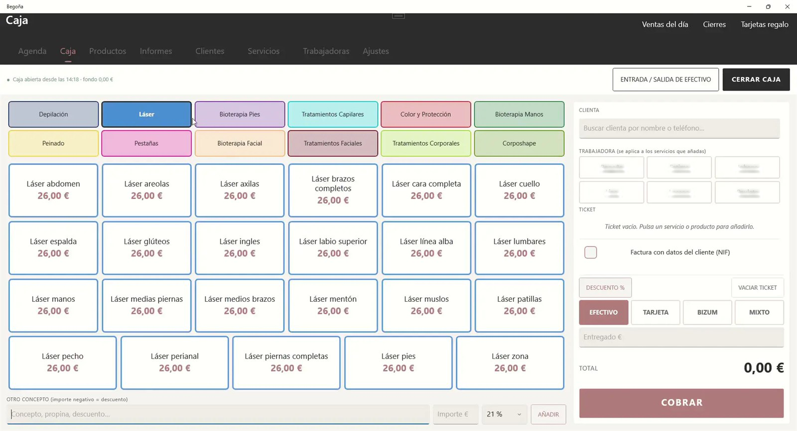
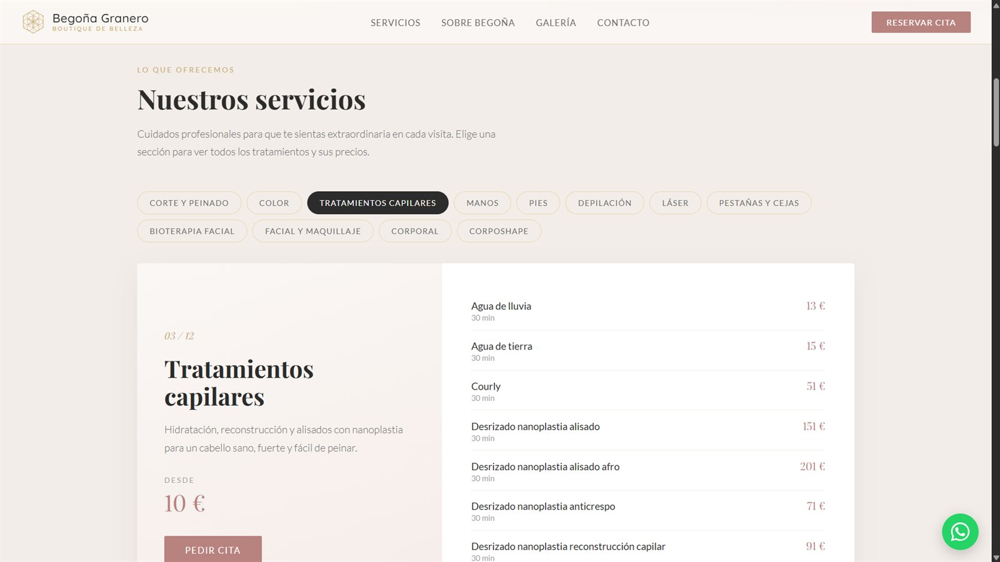
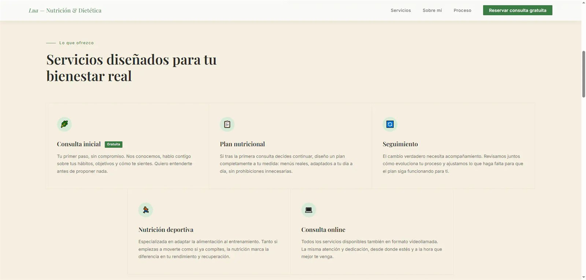

# IG Digital Studio · Portfolio

Portfolio profesional de **Ignacio Garrido**, desarrollador independiente de webs y aplicaciones a medida para pequeños negocios.

🌐 **Web publicada:** https://ignacio25-eng.github.io/Mi-Web/

El objetivo de la web es presentar servicios, mostrar proyectos y facilitar que un negocio pueda explicar qué necesita y ponerse en contacto.

## Proyectos

### Aplicación de gestión para peluquería
Aplicación de gestión con agenda, caja, stock y control del equipo.



### Web de reservas para peluquería
Web de presentación con servicios, galería y solicitud de citas online.



### Web para dietética
Web de presentación de servicios y proceso de trabajo.



## Qué incluye el portfolio

- Presentación de servicios de desarrollo web, aplicaciones de gestión y mejoras/automatizaciones.
- Galería de proyectos con capturas y ventanas de detalle.
- Diseño adaptable a móvil, tablet y escritorio.
- Formulario de contacto y formulario de opiniones con envío por FormSubmit.
- Revisión manual de las opiniones antes de publicarlas.
- Preguntas frecuentes, aviso legal y política de privacidad.
- Metadatos para compartir en redes y datos estructurados JSON-LD.
- Navegación por teclado y soporte para movimiento reducido.

## Tecnologías

- **HTML5** para la estructura.
- **CSS3** para el diseño responsive y las animaciones.
- **JavaScript** sin framework para interacciones, formularios y ventanas de detalle.
- **ASP.NET Core / .NET 10** como servidor local sencillo para abrir la web desde Visual Studio o con `dotnet run`.
- **GitHub Pages** para publicar la versión estática.

## Ejecutar en local

Necesitas tener instalado el SDK de **.NET 10**.

```bash
dotnet restore
dotnet run
```

Con el perfil incluido en el proyecto, la web se abre en:

```
http://localhost:5080
```

También puedes abrir directamente `index.html` en un navegador para revisar la versión estática.

## Estructura principal

```text
Mi-Web/
├── img/
│   └── capturas/     # Capturas de los proyectos
├── Properties/
│   └── launchSettings.json
├── index.html        # Portfolio, estilos y JavaScript
├── Program.cs        # Servidor local ASP.NET Core
└── Mi-Web.csproj     # Proyecto .NET 10
```

## Formularios y privacidad

Los formularios envían los datos introducidos mediante FormSubmit para poder responder a las consultas y revisar las opiniones recibidas. Las opiniones no se publican automáticamente: se revisan antes de añadirse a la web.

Consulta el aviso legal y la política de privacidad incluidos en el propio sitio para conocer los datos tratados y los derechos de las personas usuarias.

---

© Ignacio Garrido · IG Digital Studio
